# @qudag/mcp-sse

[](https://www.npmjs.com/package/@qudag/mcp-sse)

A QuDAG [Model Context Protocol](https://modelcontextprotocol.io) server over HTTP (JSON-RPC 2.0 on `POST /mcp`), with OAuth2/JWT authentication, role-based access control and rate limiting. Key exchange and signing use post-quantum cryptography (ML-KEM-768, ML-DSA-65) through [`@qudag/napi-core`](https://www.npmjs.com/package/@qudag/napi-core). The circuit and health tools are simulators.



## Quickstart

```bash
npm install @qudag/mcp-sse
# local development: plain HTTP on loopback, no auth
QUDAG_PROTOCOL=http QUDAG_HOST=127.0.0.1 QUDAG_PORT=3000 QUDAG_REQUIRE_AUTH=false npx qudag-mcp-sse &

curl -s localhost:3000/mcp -H 'content-type: application/json' \
  -d '{"jsonrpc":"2.0","id":1,"method":"tools/call","params":{"name":"quantum_key_exchange","arguments":{"algorithm":"ml-kem-768","role":"initiator"}}}'
# {"jsonrpc":"2.0","id":1,"result":{"content":[{"type":"text","text":"{\"public_key\":\"...\",\"metadata\":{\"key_id\":\"key_...\"}}"}]}}
```

As a library:

```js
const { QuDAGMcpServer } = require('@qudag/mcp-sse');
const server = new QuDAGMcpServer();   // configuration comes from QUDAG_* environment variables
server.start().then(() => console.log('listening on port', server.getPort()));
```

Subpath exports: `@qudag/mcp-sse/auth` (OAuth2 manager, RBAC) and `@qudag/mcp-sse/middleware` (rate limiting, security headers).

## Tools

| Tool | What it does |
|---|---|
| `quantum_key_exchange` | ML-KEM-768. `initiator` without `peer_public_key` returns `public_key` + `key_id` (secret key held by the server); with `peer_public_key` it returns `encapsulated_key` + `shared_secret`; `responder` with `key_id` + `encapsulated_key` returns `shared_secret`. Other parameter sets return an error. |
| `quantum_sign` | ML-DSA-65. `private_key` is `"generate"` or a `key_id` from an earlier call; the result includes the public key. |
| `execute_quantum_dag`, `optimize_circuit`, `analyze_complexity`, `benchmark_performance`, `system_health_check` | Simulated results. |

## Configuration

| Variable | Default | Notes |
|---|---|---|
| `QUDAG_REQUIRE_AUTH` | `true` | With auth required and no `QUDAG_OAUTH2_ISSUER_URL`, every request except `GET /health` gets 401. |
| `QUDAG_OAUTH2_ISSUER_URL`, `QUDAG_OAUTH2_AUDIENCE`, `QUDAG_OAUTH2_JWKS_URL` | none, `qudag-mcp-api`, `<issuer>/.well-known/jwks.json` | Bearer JWTs are verified against the issuer's JWKS (RS*/ES*). |
| `QUDAG_PROTOCOL` | `https` | `https` needs `QUDAG_TLS_CERT_PATH` and `QUDAG_TLS_KEY_PATH`. |
| `QUDAG_HOST`, `QUDAG_PORT` | `0.0.0.0`, `3000` | |
| `QUDAG_RATE_LIMIT` | `600` | Requests per minute per user or IP. |
| `QUDAG_CORS_ORIGINS` | `http://localhost:3000` | Comma-separated. |

Roles come from the token's `roles` claim (default `user`). In this release `tools/list` is open to any valid token and `tools/call` requires the `admin` role.

Server-held keys live in memory only, keyed by random UUIDs, and are discarded on restart. The native crypto binary covers Linux x64/arm64 (glibc 2.34+); elsewhere the crypto tools return an error. Node.js 18 or later.

## License

MIT. Source: [packages/mcp-sse](https://github.com/ruvnet/QuDAG/tree/main/packages/mcp-sse). More at [ruv.io](https://ruv.io).
