# @qudag/mcp-stdio

[](https://www.npmjs.com/package/@qudag/mcp-stdio)

A [Model Context Protocol](https://modelcontextprotocol.io) server over stdio for QuDAG. Its key exchange and signing tools run post-quantum cryptography (ML-KEM-768, ML-DSA-65) from the Rust crates through [`@qudag/napi-core`](https://www.npmjs.com/package/@qudag/napi-core). The circuit, DAG, network and health tools are simulators.



## Quickstart

Add it to Claude Desktop (`claude_desktop_config.json`) or any MCP client:

```json
{
  "mcpServers": {
    "qudag": { "command": "npx", "args": ["-y", "@qudag/mcp-stdio"] }
  }
}
```

Or drive it from Node with the MCP SDK (`npm install @qudag/mcp-stdio @modelcontextprotocol/sdk`):

```js
// quickstart.mjs
import { Client } from '@modelcontextprotocol/sdk/client/index.js';
import { StdioClientTransport } from '@modelcontextprotocol/sdk/client/stdio.js';

const client = new Client({ name: 'demo', version: '1.0.0' });
await client.connect(new StdioClientTransport({ command: 'npx', args: ['qudag-mcp-stdio'] }));
const kex = async (args) =>
  JSON.parse((await client.callTool({ name: 'quantum_key_exchange', arguments: { algorithm: 'ml-kem-768', ...args } })).content[0].text);

const alice = await kex({ role: 'initiator' });                                   // key pair, secret key stays in the server
const bob = await kex({ role: 'initiator', peer_public_key: alice.public_key });  // encapsulate
const back = await kex({ role: 'responder', key_id: alice.metadata.key_id, encapsulated_key: bob.encapsulated_key });
console.log('same 32-byte secret:', back.shared_secret === bob.shared_secret);
await client.close();
```

```
$ node quickstart.mjs
QuDAG MCP STDIO server started
same 32-byte secret: true
```

## Tools

| Tool | What it does |
|---|---|
| `quantum_key_exchange` | ML-KEM-768 (FIPS 203). `initiator` without `peer_public_key` generates a key pair and returns `public_key` + `key_id`; `initiator` with `peer_public_key` encapsulates and returns `encapsulated_key` + `shared_secret`; `responder` with `key_id` + `encapsulated_key` decapsulates. `ml-kem-512`/`ml-kem-1024` return an error. |
| `quantum_sign` | ML-DSA-65 (FIPS 204). `private_key` is a key handle: `"generate"` creates a server-held key, or pass a `key_id` from an earlier call. The result carries the public key for verification. `ml-dsa-44`/`ml-dsa-87` return an error. |
| `vault_quantum_store`, `vault_quantum_retrieve` | Not available in this release; they always return an error. |
| `execute_quantum_dag`, `optimize_circuit`, `analyze_complexity`, `benchmark_performance` | Simulated circuit results for prototyping agents. |
| `dark_address_resolve`, `system_health_check` | Simulated. Signature verification is reported as `not_performed`. |

Resource templates (`resources/templates/list`): `quantum://`, `dag://`, `crypto://keys/{key_id}` (public keys generated in this process), `crypto://algorithms`, `network://`, `system://status`.

## Notes

- Secret keys never leave the server process and are not persisted; a restart discards them. Key ids are random UUIDs.
- Crypto needs the native binary from `@qudag/napi-core` (Linux x64/arm64, glibc 2.34+). Elsewhere the crypto tools return an error and the simulators still work.
- Node.js 18 or later.

## License

MIT. Source: [packages/mcp-stdio](https://github.com/ruvnet/QuDAG/tree/main/packages/mcp-stdio). More at [ruv.io](https://ruv.io).
