# @qudag/napi-core

[](https://www.npmjs.com/package/@qudag/napi-core)

Post-quantum cryptography and the QuDAG DAG for Node.js, as Rust N-API bindings over the
[`qudag-crypto`](https://crates.io/crates/qudag-crypto) and `qudag-dag` crates.



- **ML-KEM-768** key encapsulation (keygen / encapsulate / decapsulate)
- **ML-DSA** signatures (sign / verify / batch verify)
- **HQC-128/192/256** key generation
- **Quantum fingerprints** (BLAKE3 + ML-DSA)
- **QuantumDag**: an in-memory DAG of messages

## Platforms

Prebuilt binaries ship for **Linux x64 and arm64 (glibc 2.34+**: Ubuntu 22.04, Debian 12, RHEL 9 and newer).
Other platforms are not published yet; build from source with `npm run build` in `packages/napi-core`.

## Quickstart

```bash
npm install @qudag/napi-core
```

```js
const { MlKem, MlDsaKeyPair } = require('@qudag/napi-core');

// ML-KEM-768: Bob publishes pk, Alice encapsulates, Bob decapsulates
const bob = MlKem.keygen();
const { ciphertext, sharedSecret } = MlKem.encapsulate(Buffer.from(bob.publicKey));
const bobSecret = MlKem.decapsulate(Buffer.from(bob.secretKey), Buffer.from(ciphertext));
console.log('KEM secrets match:', Buffer.from(bobSecret).equals(Buffer.from(sharedSecret)));

// ML-DSA signatures
const kp = MlDsaKeyPair.generate();
const msg = Buffer.from('hello, post-quantum world');
const sig = Buffer.from(kp.sign(msg));
console.log('signature valid:', kp.toPublicKey().verify(msg, sig));
```

Output:

```
KEM secrets match: true
signature valid: true
```

## Upgrading from 0.1.0

0.1.0 was built from an unmerged pre-v2 branch and shipped only a linux-x64 binary; its seven
platform packages were never published. Upgrade to 0.1.1 or later.

## License

MIT OR Apache-2.0. Source: https://github.com/ruvnet/QuDAG/tree/main/packages/napi-core
